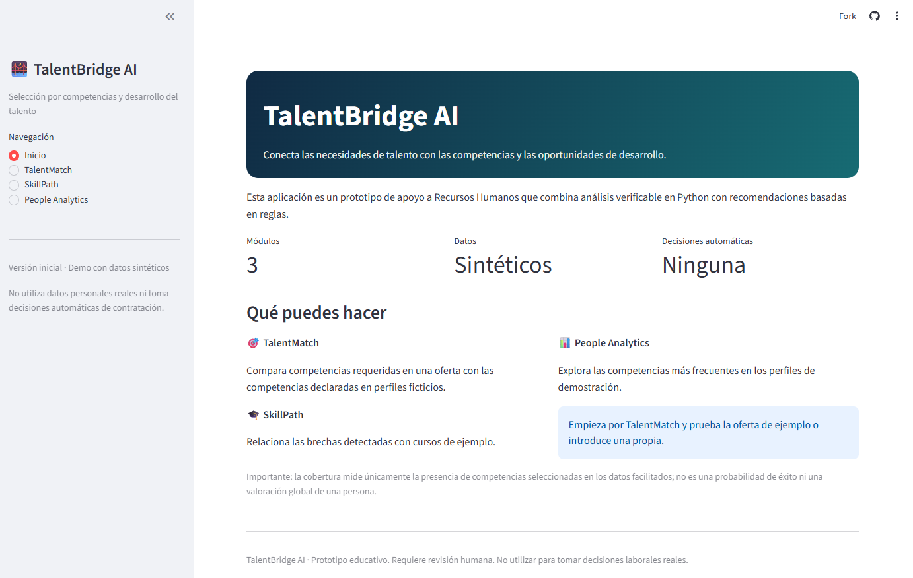
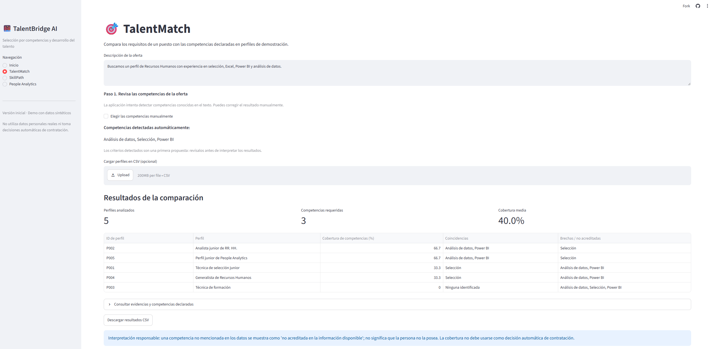
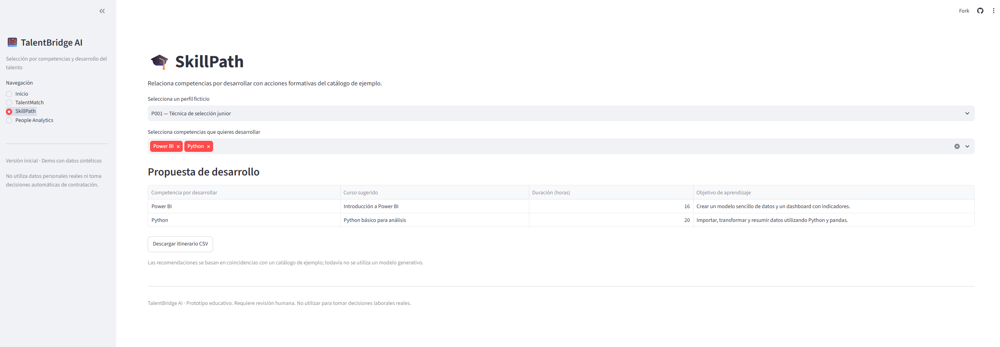
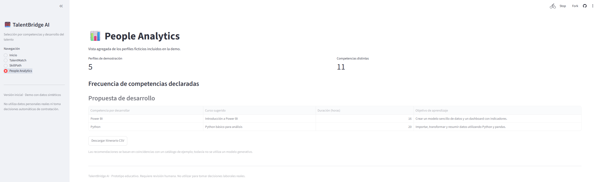

# 🌉 TalentBridge AI

### Tecnología aplicada a Recursos Humanos, gestión del talento y People Analytics

**TalentBridge AI** es un prototipo educativo desarrollado en el marco del Máster en People Analytics y Gestión del Talento Digital de la Universidad Camilo José Cela (UCJC).

El proyecto explora cómo la tecnología puede apoyar diferentes procesos de Recursos Humanos mediante la comparación de competencias profesionales, la identificación de necesidades formativas y el análisis agregado de competencias.

🔗 **Demo online:** [Probar TalentBridge AI](https://talentbridge-ai-xnnkkbaaxmncuz5kkxs2rs.streamlit.app/)

💻 **Código fuente:** [Repositorio en GitHub](https://github.com/sdfatima09/TalentBridge-AI)

---

## 🎯 Objetivo del proyecto

Explorar una solución digital que conecte tres áreas de la gestión de personas:

- **Selección por competencias:** comparación entre los requisitos de un puesto y las competencias declaradas en perfiles de demostración.
- **Desarrollo del talento:** identificación de competencias que se desean desarrollar y relación con cursos formativos.
- **People Analytics:** análisis agregado de las competencias declaradas en los perfiles sintéticos.

El objetivo es mostrar cómo los datos y las herramientas digitales pueden ayudar a organizar información y apoyar el trabajo de los profesionales de Recursos Humanos.

## 🚀 Funcionalidades principales

### 1. TalentMatch — Comparación de competencias

Permite explorar la relación entre los requisitos de una oferta y las competencias declaradas en perfiles ficticios.

Funcionalidades:
- Introducción de una descripción de puesto.
- Detección inicial de competencias conocidas.
- Revisión y selección manual de competencias.
- Comparación entre requisitos y perfiles.
- Visualización de coincidencias, brechas y evidencias disponibles.
- Cálculo del porcentaje de cobertura de las competencias seleccionadas.
- Descarga de resultados en formato CSV.

### 2. SkillPath — Desarrollo del talento

Permite relacionar las competencias que se desean desarrollar con un catálogo de cursos de demostración.

Funcionalidades:
- Selección de un perfil ficticio.
- Elección de competencias para desarrollar.
- Relación de competencias con cursos formativos.
- Consulta de duración y objetivos de aprendizaje.
- Identificación de competencias sin cursos asociados.
- Descarga del itinerario formativo.

### 3. People Analytics — Análisis de competencias

Permite explorar la distribución de competencias declaradas en los perfiles sintéticos.

Funcionalidades:
- Cálculo de frecuencias de competencias.
- Representación gráfica de los resultados.
- Consulta de una tabla agregada de competencias.

## 🖥️ Capturas de pantalla

### Inicio



### TalentMatch



### SkillPath



### People Analytics



> Las imágenes anteriores se mostrarán cuando los archivos correspondientes se hayan subido a la carpeta `screenshots` del repositorio.

## 🛠️ Tecnologías utilizadas

- **Python:** lenguaje de programación.
- **Streamlit:** desarrollo de la interfaz web interactiva.
- **pandas:** tratamiento y análisis de datos.
- **CSV:** almacenamiento y gestión de datos de demostración.
- **GitHub:** alojamiento del código fuente y documentación.
- **Streamlit Community Cloud:** publicación de la demo online.

## 📂 Estructura del proyecto

```text
TalentBridge-AI/
├── data/
│   └── Archivos CSV de demostración
├── screenshots/
│   ├── 01-inicio.png
│   ├── 02-talentmatch.png
│   ├── 03-skillpath.png
│   └── 04-people-analytics.png
├── app.py
├── requirements.txt
├── README.md
└── Analisis_funcional_y_prompt_TalentBridge_AI.pdf
```

## 💻 Instalación y ejecución local

Para ejecutar la aplicación en un entorno local, se recomienda disponer de Python 3.10 o superior.

**1. Clonar el repositorio**

```bash
git clone https://github.com/sdfatima09/TalentBridge-AI.git
```

**2. Acceder a la carpeta del proyecto**

```bash
cd TalentBridge-AI
```

**3. Crear un entorno virtual**

```bash
python -m venv .venv
```

**4. Activar el entorno virtual**

En Windows PowerShell:

```powershell
.venv\Scripts\Activate.ps1
```

En macOS o Linux:

```bash
source .venv/bin/activate
```

**5. Instalar las dependencias**

```bash
pip install -r requirements.txt
```

**6. Ejecutar la aplicación**

```bash
streamlit run app.py
```

Streamlit indicará la dirección local desde la que se puede abrir la aplicación en el navegador.

## ⚖️ Limitaciones y uso responsable

TalentBridge AI es un prototipo educativo de apoyo a tareas de Recursos Humanos. No es un sistema validado para tomar decisiones reales de contratación.

- Utiliza perfiles y datos sintéticos de demostración.
- La comparación de competencias se basa en reglas explícitas.
- El porcentaje de cobertura mide coincidencias con los criterios seleccionados; no representa una probabilidad de rendimiento ni una valoración global de una persona.
- La ausencia de una competencia en los datos no significa que la persona carezca de ella.
- Los resultados deben interpretarse con criterio humano.
- No deben introducirse datos personales reales.
- La herramienta no está diseñada para automatizar decisiones de contratación.

## 📌 Estado del proyecto

Proyecto académico en evolución, con repositorio de código y demo online.

## 👩‍💻 Autora

**Fátima Sánchez Dorado**

Máster en People Analytics y Gestión del Talento Digital — Universidad Camilo José Cela (UCJC).

Áreas de interés: People Analytics, HR Tech, Talent Management, desarrollo del talento y aplicación de tecnología a Recursos Humanos.

---

🔗 **Demo:** https://talentbridge-ai-xnnkkbaaxmncuz5kkxs2rs.streamlit.app/

💻 **GitHub:** https://github.com/sdfatima09/TalentBridge-AI
